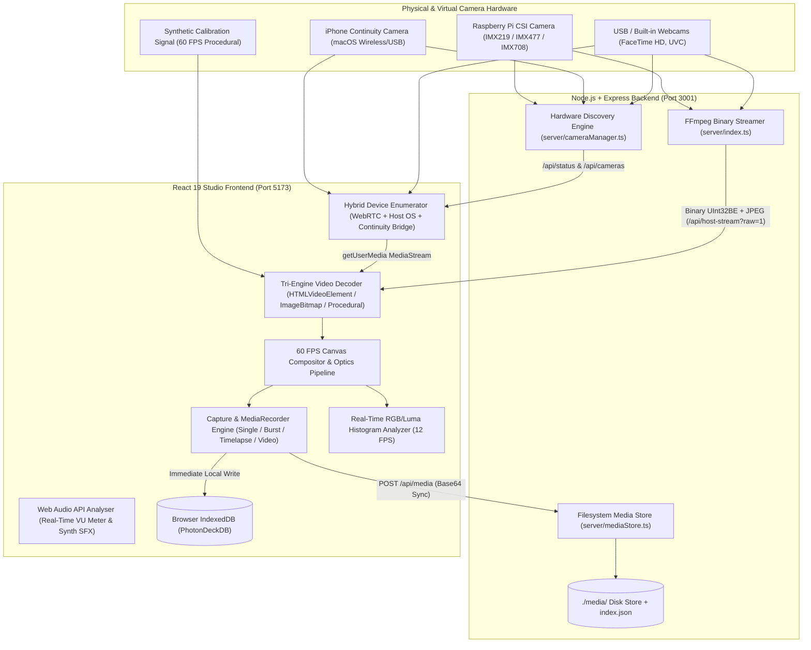
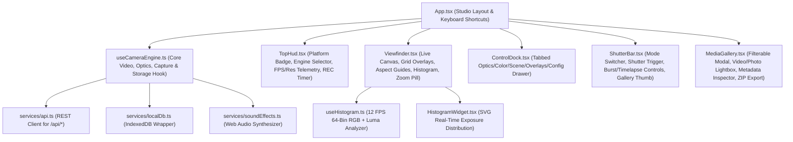
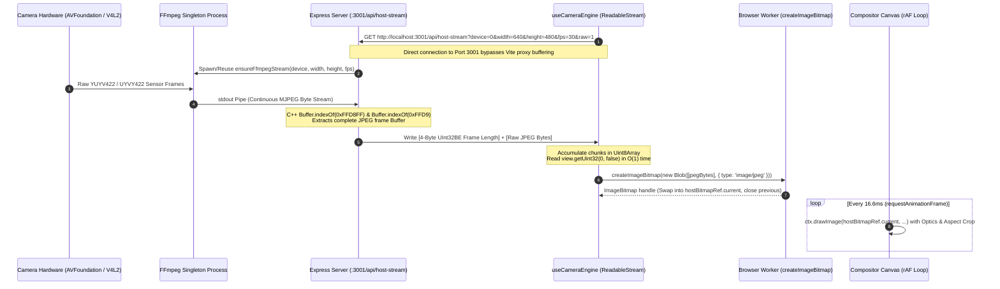
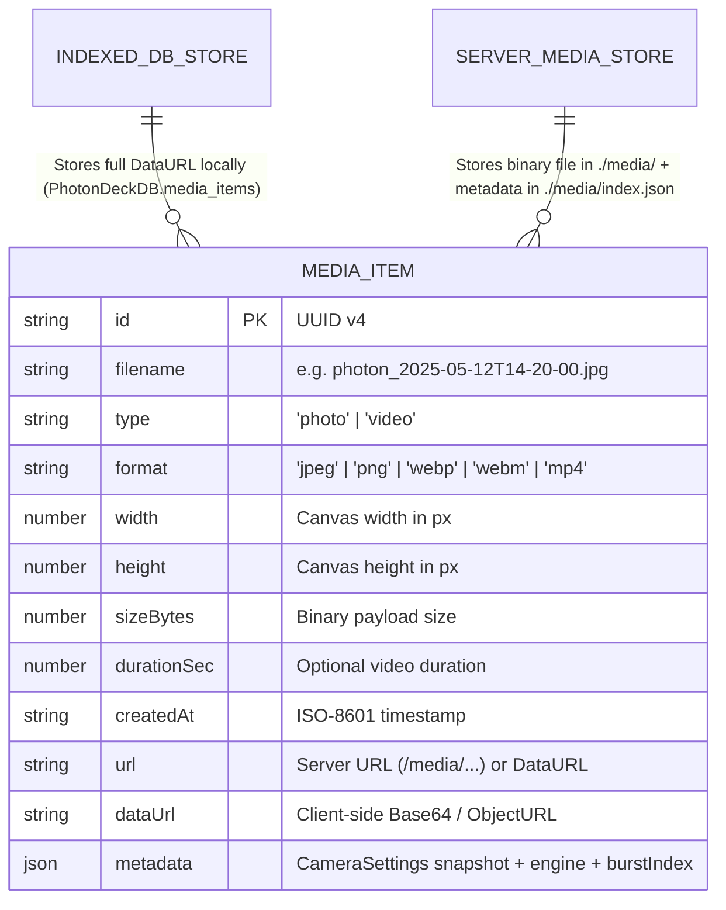

# PhotonDeck — High-Level & Detailed Technical Architecture

**PhotonDeck** is a cross-platform Camera Studio and Hardware-Aware Media Capture Platform built with a **React 19 + TypeScript + Tailwind CSS v4** frontend and a **Node.js + Express + FFmpeg** backend. It unifies browser-native **WebRTC** pipelines, **Host OS hardware drivers** (`AVFoundation`, `V4L2`/`libcamera`, `DirectShow`), **macOS iPhone Continuity Camera** wireless bridges, and a **60 FPS Synthetic Studio Calibration Generator** into a real-time 2D Canvas compositor and hybrid storage engine.

---

## Part 1: High-Level Architecture

### 1.1 Executive Overview & Design Goals

PhotonDeck is engineered around five architectural pillars:

1. **Tri-Engine Video Ingestion**: Seamless runtime switching between Browser WebRTC (`navigator.mediaDevices.getUserMedia`), low-latency Host OS FFmpeg binary streams (`/api/host-stream?raw=1`), and a procedural 60 FPS Studio Calibration Signal (`test-pattern`).
2. **Unified Real-Time Optics & Compositor**: All video sources converge into a single `requestAnimationFrame` HTML5 `<canvas>` compositor ([`useCameraEngine.ts`](src/hooks/useCameraEngine.ts)) that applies hardware or CSS color matrices, aspect-ratio center-cropping (`16:9`, `4:3`, `1:1`, `9:16`), digital zoom (`1.0x–5.0x`), horizontal mirroring, and quadrant rotation (`0°`, `90°`, `180°`, `270°`) prior to display and capture.
3. **Zero-Copy / Low-Overhead Host Streaming**: Bypasses browser multipart-image buffering bottlenecks and Vite proxy throttling by framing MJPEG output from FFmpeg into length-prefixed binary packets (`[4-byte UInt32BE length][JPEG payload]`) decoded asynchronously off the main thread via `createImageBitmap()`.
4. **Hardware-Aware Cross-Platform Discovery**: Probes OS-native camera buses across macOS (`AVFoundation` + `system_profiler SPCameraDataType` for Continuity Camera), Raspberry Pi (`rpicam-hello` / `libcamera` + `v4l2-ctl`), Linux (`V4L2`), and Windows (`DirectShow` / `PnPDevice`).
5. **Offline-First Dual-Tier Persistence**: Captures (stills, bursts, timelapses, and recorded video) write immediately to browser **IndexedDB** ([`localDb.ts`](src/services/localDb.ts)) and asynchronously replicate to the Node.js filesystem media store ([`mediaStore.ts`](server/mediaStore.ts)).

---

### 1.2 System Context & Topology Diagram



---

### 1.3 Cross-Platform Hardware Abstraction Matrix

Implemented in [`detectPlatform()`](server/cameraManager.ts#L19-L36) and [`discoverHostCameras()`](server/cameraManager.ts#L207-L234):

| Platform ID | OS / Target | Discovery Tools | FFmpeg Input Driver (`-f`) | Device Identifier Format |
| :--- | :--- | :--- | :--- | :--- |
| `macos` | macOS (Apple Silicon / Intel) | `ffmpeg -f avfoundation -list_devices true` + `system_profiler SPCameraDataType -json` | `avfoundation` | `<index>:none` (e.g., `0:none`) or `macos-continuity:<id>` |
| `raspberry-pi` | Raspberry Pi OS (`/proc/device-tree/model`) | `rpicam-hello --list-cameras` / `libcamera-hello` + `v4l2-ctl --list-devices` | `v4l2` | `/dev/video0` or `csi:<index>` |
| `linux` | Generic Linux (`process.platform === 'linux'`) | `v4l2-ctl --list-devices` + `/sys/class/video4linux/video*/name` | `v4l2` | `/dev/video0`, `/dev/video2`, etc. |
| `windows` | Windows 10/11 (`process.platform === 'win32'`) | `ffmpeg -f dshow -list_devices true` + PowerShell `Get-PnpDevice -Class Camera,Image` | `dshow` | `video=<Device Label>` |
| `browser` | All Browsers (Fallback / Primary) | `navigator.mediaDevices.enumerateDevices()` + `getUserMedia()` | N/A (WebRTC) | Browser `deviceId` hash |

---

### 1.4 Technology Stack Summary

| Layer | Technology | Role in PhotonDeck |
| :--- | :--- | :--- |
| **UI Framework** | React 19 + TypeScript 5.8 | Declarative HUD, reactive telemetry, strict typing across camera state |
| **Styling** | Tailwind CSS v4 + Lucide React | Dark-room glassmorphic studio UI (`zinc-950` palette, tactile controls) |
| **Build & Dev Server** | Vite 6 + `concurrently` + `tsx` | Parallel frontend HMR (`:5173`) and TypeScript Node server execution (`:3001`) |
| **Backend Runtime** | Node.js + Express 4 | REST API, child process lifecycle management for FFmpeg, binary stream broadcaster |
| **Media Processing** | FFmpeg (`avfoundation`/`v4l2`/`dshow`) | Low-latency hardware capture, pixel format conversion (`uyvy422`, `yuyv422`), MJPEG slice encoding |
| **Client Storage & Export** | IndexedDB + `JSZip` | Offline-first blob storage (`PhotonDeckDB`) and batch ZIP archive generation |
| **Audio Synthesis & Metering** | Web Audio API (`AudioContext`) | Zero-dependency mechanical shutter/beep synthesis ([`soundEffects.ts`](src/services/soundEffects.ts)) and live microphone RMS VU metering |

---

## Part 2: Detailed Technical Architecture

### 2.1 Frontend Component & Hook Hierarchy



#### Key Modules & Responsibilities
- **[`src/App.tsx`](src/App.tsx)**: Root orchestrator. Binds global keyboard shortcuts (`Space` to trigger shutter/recording, `G` to cycle grid overlays, `M` to toggle mirror, `H` to toggle histogram, `Escape` to close modals), manages active control tabs, and coordinates optimistic deletion with `deletedIdsRef`.
- **[`src/hooks/useCameraEngine.ts`](src/hooks/useCameraEngine.ts)**: The central state machine and rendering heart of the application. Manages device discovery, active stream lifecycle, the 60 FPS compositor loop, image/video capture modes, and dual-tier storage synchronization.
- **[`src/hooks/useHistogram.ts`](src/hooks/useHistogram.ts)**: Samples the live compositor `<canvas>` at 12 FPS (`85ms` interval) into a `160×90` offscreen canvas, computing 64-bin Red, Green, Blue, and Rec.709 Luminance ($Y = 0.2126R + 0.7152G + 0.0722B$) histograms normalized to $0\text{–}100\%$.
- **[`src/components/Viewfinder.tsx`](src/components/Viewfinder.tsx)**: Renders the primary `<canvas>`, Rule-of-Thirds (`thirds`), Golden Ratio (`phi`: $38.2\% / 61.8\%$), Crosshair (`crosshair`), Safe Frame (`80%` broadcast, `90%` action), Aspect Guide (`2.35:1` Anamorphic, `1:1`, `9:16`, `4:3`), Horizon Level indicator, and interactive quick-zoom pills (`1x`, `1.5x`, `2x`, `3x`, `5x`).

---

### 2.2 Tri-Engine Video Pipeline & State Machine

PhotonDeck supports three distinct video ingestion engines defined by `StreamEngine = 'webrtc' | 'host' | 'test-pattern'` in [`src/types/camera.ts`](src/types/camera.ts#L1-L6).

```mermaid
stateDiagram-v2
    [*] --> Initializing: Mount useCameraEngine()
    Initializing --> DiscoveringDevices: Fetch /api/status + Permission Probe + enumerateDevices()

    DiscoveringDevices --> WebRTCEngine: Select Browser Camera / Continuity Bridge
    DiscoveringDevices --> HostStreamEngine: Select Host OS Camera (AVFoundation / V4L2 / DirectShow)
    DiscoveringDevices --> TestPatternEngine: Select Studio Calibration Signal or Hardware Fallback

    state WebRTCEngine {
        [*] --> RequestGetUserMedia
        RequestGetUserMedia --> OffscreenVideoElement: videoRef.srcObject = MediaStream
        OffscreenVideoElement --> WebAudioAnalyser: AudioContext -> AnalyserNode (VU Meter)
    }

    state HostStreamEngine {
        [*] --> CheckContinuityCamera
        CheckContinuityCamera --> ContinuityWebRTCBridge: device.id starts with macos-continuity:
        CheckContinuityCamera --> BinaryFetchStream: Connect :3001/api/host-stream?raw=1
        BinaryFetchStream --> ParseUInt32BELength: Read 4B header + JPEG slice
        ParseUInt32BELength -->OffThreadDecode: createImageBitmap(Blob) -> hostBitmapRef
        BinaryFetchStream --> HostFramePollerFallback: On Stream Error (/api/host-frame)
    }

    state TestPatternEngine {
        [*] --> ProceduralGenerator: drawStudioCalibrationScene(ctx, w, h, timestamp)
    }

    WebRTCEngine --> CanvasCompositor: 60 FPS requestAnimationFrame
    HostStreamEngine --> CanvasCompositor: 60 FPS requestAnimationFrame
    TestPatternEngine --> CanvasCompositor: 60 FPS requestAnimationFrame
```

---

### 2.3 High-Throughput Host OS Binary Streaming Protocol (`/api/host-stream?raw=1`)

Standard MJPEG over HTTP (`multipart/x-mixed-replace` bound to an `` tag) suffers from severe browser buffer stalls and Vite dev-server proxy chunk coalescing, often dropping frame rates to `<8 FPS` or freezing after the first frame. PhotonDeck implements a custom **Length-Prefixed Binary Frame Protocol** between [`server/index.ts`](server/index.ts#L91-L320) and [`src/hooks/useCameraEngine.ts`](src/hooks/useCameraEngine.ts#L222-L335).

#### Sequence Diagram: End-to-End Host OS Frame Delivery



#### Low-Latency FFmpeg Pipeline Parameters
Configured in [`ensureFfmpegStream()`](server/index.ts#L98-L162):
- **Input Probing Elimination**: `-probesize 32 -analyzeduration 0 -fflags nobuffer -flags low_delay` starts frame emission immediately without waiting to buffer multi-second stream headers.
- **Sensor Negotiation (macOS AVFoundation)**: Always captures from the hardware sensor at native `1280x720` (`-video_size 1280x720 -framerate 30 -pixel_format uyvy422|yuyv422|nv12`) to prevent driver rejection on FaceTime HD cameras, then downscales in-flight via `-vf scale=${targetW}:${targetH}:flags=fast_bilinear` when a smaller resolution (e.g., `640×480`) is requested.
- **Multi-Threaded Slice MJPEG Encoding**: `-fps_mode passthrough -threads 2 -thread_type slice -f image2pipe -vcodec mjpeg -pix_fmt yuvj422p -huffman default -q:v 6 -flush_packets 1 pipe:1` minimizes per-frame compression latency and flushes every packet immediately.
- **Graceful Process Reference Counting**: Multiple concurrent client connections to the same device/resolution share a single `ActiveFfmpegStream` instance (`clients: Set<Response>`). When the last client disconnects, a `1500ms` grace timer (`idleTimer`) keeps the hardware warm across React strict-mode remounts or resolution toggles before sending `SIGTERM`.

---

### 2.4 macOS Continuity Camera (iPhone) Discovery & Hybrid Bridging

Modern macOS releases deprecate legacy DAL plugins in favor of `ContinuityCaptureAgent` (CoreMediaIO extension). Consequently, `ffmpeg -f avfoundation -list_devices true` often omits wireless iPhone Continuity Cameras until an active session is established, while `system_profiler SPCameraDataType -json` always lists them.

PhotonDeck solves this via a two-stage hybrid discovery and bridging pipeline:

1. **Backend CoreMediaIO Inspection ([`discoverMacOSCameras()`](server/cameraManager.ts#L42-L120))**:
   - Runs `ffmpeg -f avfoundation -list_devices true -i ""` to gather indexed AVFoundation video devices (`0:none`, `1:none`, etc.).
   - Runs `system_profiler SPCameraDataType -json` in parallel and inspects the `spcamera_datatype` array.
   - Identifies iPhone Continuity Cameras via `model_id` / `_name` matching (`iPhone`, `Continuity`, `ContinuityCaptureDevice`) and merges any unindexed devices into the response with a synthetic ID `macos-continuity:<model_id>`.
2. **Frontend WebRTC Permission Unlock & Bridge ([`useCameraEngine.ts`](src/hooks/useCameraEngine.ts#L107-L202))**:
   - Executes a momentary `navigator.mediaDevices.getUserMedia({ video: true, audio: false })` probe prior to `enumerateDevices()` so the browser unlocks full hardware labels (e.g., `"iPhone Camera"` / `"Continuity Camera"`).
   - Subscribes to `navigator.mediaDevices.addEventListener('devicechange', ...)` so waking an iPhone on the same Wi-Fi/Apple ID dynamically updates the camera selector dropdown.
   - When the user selects a `macos-continuity:*` device (or when a WebRTC device matches the host camera name), [`startStream()`](src/hooks/useCameraEngine.ts#L343-L386) automatically bridges the request to WebRTC `getUserMedia` with the matched browser `deviceId`, activating the wireless iPhone video feed seamlessly.

---

### 2.5 Real-Time Canvas Compositor & Optics Math

Every animation frame in [`useCameraEngine.ts`](src/hooks/useCameraEngine.ts#L454-L553) executes the following pipeline on the primary `<canvas>`:

#### 1. Target Aspect Ratio & Resolution Calculation
Given requested resolution $(W_{\text{req}}, H_{\text{req}})$ and selected aspect ratio $R \in \{16:9, 4:3, 1:1, 9:16\}$:
- For `16:9`: $(W_c, H_c) = (W_{\text{req}}, \text{round}(W_{\text{req}} \cdot \frac{9}{16}))$
- For `4:3`: $(W_c, H_c) = (W_{\text{req}}, \text{round}(W_{\text{req}} \cdot \frac{3}{4}))$
- For `1:1`: $(W_c, H_c) = (H_{\text{req}}, H_{\text{req}})$
- For `9:16`: $(W_c, H_c) = (\text{round}(H_{\text{req}} \cdot \frac{9}{16}), H_{\text{req}})$

#### 2. Source Center-Cropping & Digital Zoom ($Z \in [1.0, 5.0]$)
Given raw source frame dimensions $(W_s, H_s)$, source aspect $A_s = W_s / H_s$, and canvas aspect $A_c = W_c / H_c$:

$$\text{Base Crop } (W_{\text{crop}}, H_{\text{crop}}) = \begin{cases} (H_s \cdot A_c,\; H_s) & \text{if } A_s > A_c \\ (W_s,\; W_s / A_c) & \text{if } A_s \le A_c \end{cases}$$

Applying digital zoom factor $Z$:

$$s_w = \frac{W_{\text{crop}}}{Z}, \quad s_h = \frac{H_{\text{crop}}}{Z}, \quad s_x = \frac{W_s - s_w}{2}, \quad s_y = \frac{H_s - s_h}{2}$$

#### 3. Affine Transform Matrix (Mirroring & Quadrant Rotation)
Before drawing the cropped source rectangle $(s_x, s_y, s_w, s_h)$ onto the destination $(-W_c/2, -H_c/2, W_c, H_c)$, the 2D context applies:
1. Translation to center: `ctx.translate(W_c / 2, H_c / 2)`
2. Horizontal Mirror: `if (mirror) ctx.scale(-1, 1)`
3. Rotation ($\theta \in \{0^\circ, 90^\circ, 180^\circ, 270^\circ\}$): `ctx.rotate(rotation * Math.PI / 180)`

#### 4. Color Grading & Scene Presets
Computed via [`buildCssFilter(settings)`](src/hooks/useCameraEngine.ts#L560-L607), combining manual sliders and scene presets (`standard`, `vivid`, `cinematic`, `monochrome`, `night`, `portrait`) into a composite filter pipeline:
- **Brightness**: `100 + brightness + exposure * 0.6` (%)
- **Contrast**: `contrast` (%)
- **Saturation**: `saturation` (%)
- **Color Temperature Approximation**: Warm temperatures (`>5500K`) apply proportional `sepia()` warming; cool temperatures (`<5500K`) apply slight `hue-rotate(-10deg)`.
- **Burned-In Timestamp Watermark**: When `showTimestamp` is enabled, renders a bottom-right HUD pill (`YYYY-MM-DD HH:MM:SS.mmm // PHOTONDECK`) directly into the canvas bitmap so captured photos and videos retain the telemetry stamp.

---

### 2.6 Capture Modes & Media Encoding Pipeline

PhotonDeck supports four capture modes managed in [`useCameraEngine.ts`](src/hooks/useCameraEngine.ts#L609-L835):

| Mode | Trigger Function | Technical Mechanism |
| :--- | :--- | :--- |
| **Single Photo** (`single`) | `triggerShutter()` -> `captureStillFrame()` | Optional countdown timer (`0s`, `3s`, `5s`, `10s`) with synthesized 880Hz/1320Hz audio beeps, screen-flash trigger (`180ms`), and `canvas.toDataURL(mimeType, quality)` in `image/jpeg`, `image/png`, or `image/webp`. |
| **Burst Mode** (`burst`) | `startBurstCapture()` | Fires `burstCount` (`3`, `5`, or `10`) rapid sequential captures spaced by `burstIntervalMs` (`100ms–500ms`), tagging each item's metadata with `{ burstIndex, burstTotal }`. |
| **Time-Lapse** (`timelapse`) | `toggleTimelapse()` | Schedules a recurring `setInterval` (`1s` to `60s`) that captures frames continuously until toggled off, incrementing `timelapseFrameCount`. |
| **Video Recording** (`video`) | `toggleRecording()` | Captures the compositor canvas stream at target FPS via `canvas.captureStream(fps)`, merges live microphone audio tracks from `streamRef` if unmuted, and encodes via `MediaRecorder` (`8 Mbps` target bitrate). |

#### Video Codec Negotiation Order
`toggleRecording()` probes `MediaRecorder.isTypeSupported()` in priority order:
1. `video/mp4;codecs=avc1.42E01E,mp4a.40.2` (H.264 + AAC in MP4 container)
2. `video/mp4`
3. `video/webm;codecs=vp9,opus` (VP9 + Opus in WebM container)
4. `video/webm;codecs=vp8,opus`
5. `video/webm`

Supports live **Pause / Resume** (`mediaRecorder.pause()` / `resume()`) with pause-duration deduction so the HUD recording timer reflects exact encoded video duration, plus **Still Frame Grab While Recording** via a dedicated secondary shutter button in [`ShutterBar.tsx`](src/components/ShutterBar.tsx).

---

### 2.7 Dual-Tier Hybrid Persistence Architecture



1. **Tier 1 — Browser IndexedDB ([`src/services/localDb.ts`](src/services/localDb.ts))**:
   - Database: `PhotonDeckDB` (Version `1`), Object Store: `media_items` (keyPath: `id`, index: `createdAt`).
   - Every captured photo or recorded video is written to IndexedDB **first** (`saveLocalMedia`), guaranteeing zero data loss even if the Node.js backend is offline or unreachable.
2. **Tier 2 — Node.js Filesystem Store ([`server/mediaStore.ts`](server/mediaStore.ts))**:
   - `saveMediaToServer()` sends the Base64 data URL and metadata to `POST /api/media`.
   - The server strips the `data:<mime>;base64,` prefix, converts the payload into a Node `Buffer`, sanitizes the filename via `path.basename()`, writes the raw binary file to `./media/<filename>`, and prepends the metadata record to `./media/index.json`.
   - Static files are served directly via `app.use('/media-files', express.static('./media'))`.
3. **Gallery Reconciliation & Tombstone Tracking**:
   - On startup, `useCameraEngine` merges items from both `GET /api/media` and `getAllLocalMedia()`, deduplicating by `id`.
   - Deleted item IDs are tracked in `deletedIdsRef` so asynchronous in-flight saves cannot resurrect an item that the user deleted moments after capture.

---

### 2.8 Backend REST & Streaming API Specification

Implemented in [`server/index.ts`](server/index.ts):

| Method | Endpoint | Query / Body Parameters | Response Format | Description |
| :--- | :--- | :--- | :--- | :--- |
| `GET` | `/api/system-info` | None | `application/json` (`SystemInfoResponse`) | Returns host platform (`macos`, `raspberry-pi`, `linux`, `windows`), architecture, hostname, FFmpeg/V4L2/rpicam availability, and discovered host & Continuity cameras. |
| `GET` | `/api/host-stream` | `deviceId`, `width`, `height`, `fps`, `raw` (`1` or `0`) | `application/octet-stream` (`raw=1`) or `multipart/x-mixed-replace` | Attaches to the singleton FFmpeg capture process for the specified device and streams live length-prefixed binary or multipart MJPEG frames. |
| `GET` | `/api/host-frame` | `deviceId`, `width`, `height`, `fps` | `image/jpeg` + Header `X-Frame-Seq` | Returns the latest cached JPEG frame from the active FFmpeg stream for polling fallback clients. |
| `GET` | `/api/media` | None | `application/json` (`{ items: StoredMediaMetadata[] }`) | Lists all persisted media items from `./media/index.json`. |
| `POST` | `/api/media` | `{ id, filename, dataUrl, type, format, mimeType, width, height, ... }` | `application/json` (`{ item: StoredMediaMetadata }`, HTTP `201`) | Decodes Base64 media payload, writes sanitized binary file to `./media/`, and updates `./media/index.json`. |
| `DELETE` | `/api/media/:id` | `:id` (URL Param) | `application/json` (`{ deleted: boolean }`) | Deletes the binary media file from disk and removes its entry from `./media/index.json`. |
| `POST` | `/api/media/batch-delete` | `{ ids: string[] }` | `application/json` (`{ deletedCount: number }`) | Bulk-deletes multiple media items by ID from `./media/` and `./media/index.json`. |

---

### 2.9 Key Performance & Latency Optimizations

1. **Direct Port 3001 Binary Streaming**: In development, Vite's HTTP proxy (`:5173 -> :3001`) coalesces streaming chunks, introducing 150–400ms of jitter. [`getStreamBaseUrl()`](src/services/api.ts#L50-L57) routes `/api/host-stream` directly to `http://<hostname>:3001` when running on port `5173`.
2. **$O(1)$ Frame Boundary Extraction**: Instead of scanning every incoming byte in JavaScript for JPEG `0xFFD8` / `0xFFD9` markers on the client, the Node backend uses V8's native C++ `Buffer.indexOf()` and prepends a 4-byte `UInt32BE` byte-length header (`?raw=1`). The browser reads the exact frame slice in $O(1)$ via `DataView.prototype.getUint32(0, false)`.
3. **Off-Main-Thread JPEG Decoding**: Captured host JPEG slices are decoded via `createImageBitmap(blob)` on browser background worker threads, and the previous `ImageBitmap` is explicitly released via `.close()` to prevent GPU texture memory leaks.
4. **Decoupled Histogram Sampling**: [`useHistogram.ts`](src/hooks/useHistogram.ts) downsamples the viewfinder onto a `160×90` offscreen canvas at `12 FPS` (`85ms` interval) with `willReadFrequently: true`, keeping main-thread CPU usage under `0.5ms` per sample while maintaining 60 FPS viewfinder rendering.
